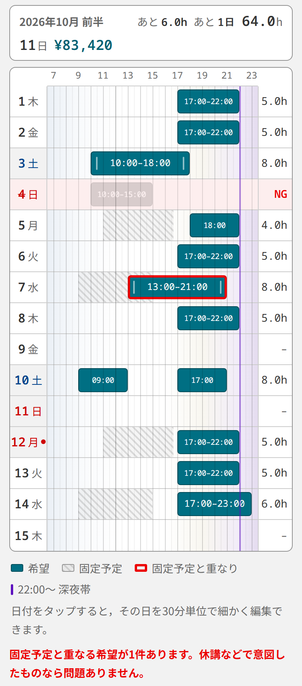
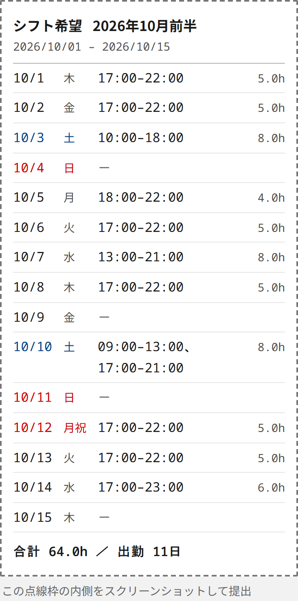
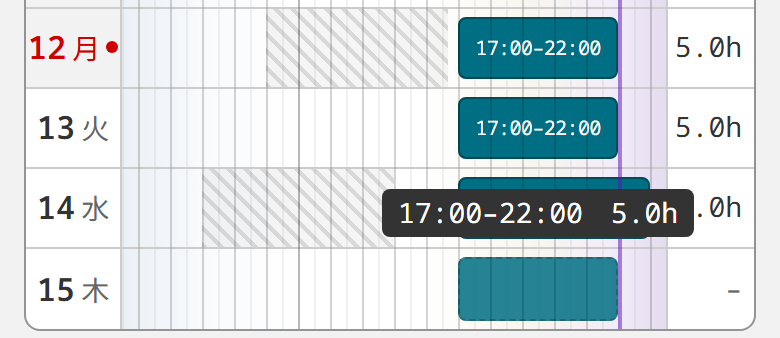
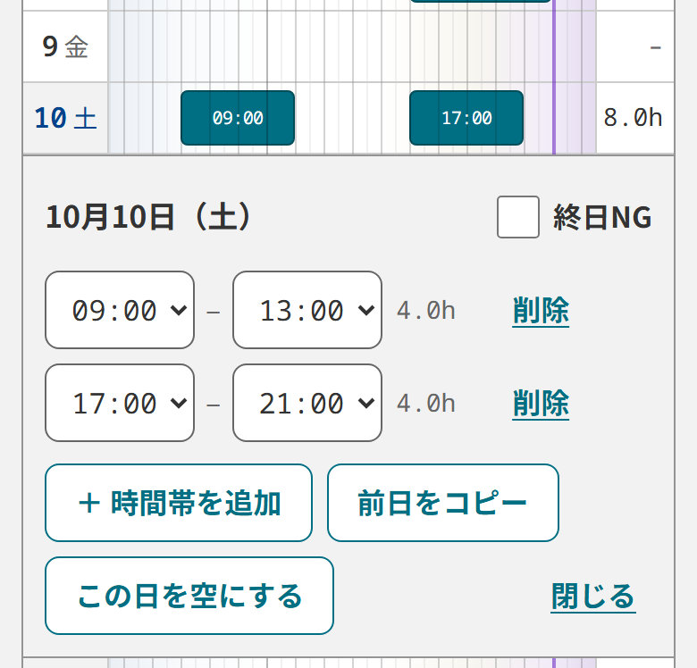
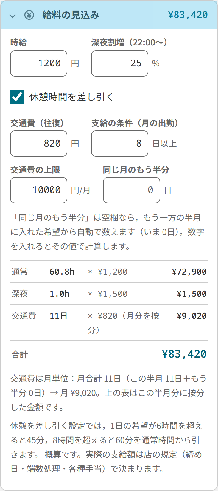
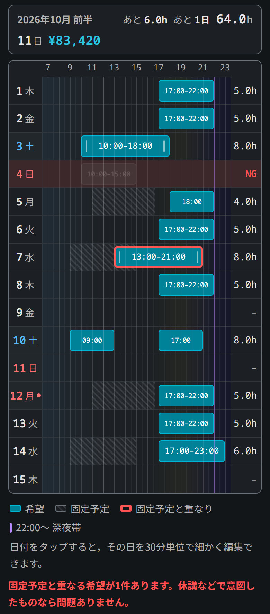

# シフト希望ボード

アルバイトのシフト希望を半月ごとに入力し、店に出す一覧をスマホでスクリーンショットするための Web アプリ。
ブラウザで動き、スマホのホーム画面に追加するとアプリのように開ける。入力した内容はその端末の中にだけ保存し、サーバーには送らない。

**アプリ：https://sota28hizumi.github.io/shift-board/**

<p align="center">
  
  
</p>

画面写真はサンプルデータ（2026年10月前半）で、幅 390px のスマホで撮った。

## 使い方

1. 提出する半月の1ヶ月前に開く（例：10月前半の希望は9月前半に出す）。開くと、提出対象の半月（今日の半月の1ヶ月先）が出る。
2. 「希望を入力 ↓」でタイムラインに移り、入れる時間帯を横になぞる。
3. 細かく直したい日は日付をタップし、編集パネルで30分単位に合わせる。
4. 画面上部の点線枠の中をスクリーンショットして店に送る。文字で送るときは「提出用テキスト」からコピーする。

### ホーム画面に追加する

- iPhone：Safari で開き、共有ボタン →「ホーム画面に追加」
- Android：Chrome のメニュー →「ホーム画面に追加」または「アプリをインストール」

iPhone では、ホーム画面から開いたアプリと Safari とで保存データが別になる。ホーム画面に追加してから入力する。

## 機能

### タイムラインで半月分をまとめて入れる

縦に半月分の日付、横に 6:30〜23:30 を並べる。空いているところを横にドラッグすると、30分刻みで希望のバーができる。
ドラッグ中はバーの上に「17:00–22:00　5.0h」のように時刻と長さが出る。



- バーの端をドラッグして伸び縮みさせ、× で消す。同じ日に重なったり隣り合ったりしたバーは1本にまとまる。
- 1日に複数の時間帯を置ける。
- 日曜・祝日は赤、土曜は青で表示する。祝日はアプリの中で計算するので、年が変わっても更新はいらない。
- 22:00 から先は深夜帯として紫の線で区切る。
- 行の右端に、その日の合計時間が出る。

### 日付をタップして30分単位で直す

日付をタップすると、その日の編集パネルが開く。時間帯ごとに開始・終了を選び直せるほか、
「＋ 時間帯を追加」「前日をコピー」「この日を空にする」と、終日NG の切り替えがここにまとまっている。



### 授業などの固定予定を表示する

曜日ごとの固定予定（授業・研究など）を斜線で表示する。休講の日に備えて、固定予定の上にも希望を置ける。
重なったバーは赤枠になり、タイムラインの下に「固定予定と重なる希望が1件あります」と出る。
固定予定は「固定予定（授業・研究）」パネルで、曜日・開始・終了・メモを1行ずつ追加・編集する。

### 終日NG と一括入力

- 終日NG：入れない日に付けると行が薄い赤になり、提出用の一覧・合計・給料から外れる。入れてあったバーは薄く残り、NG を外すと元に戻る。
  スマホでは編集パネルから、幅の広い画面では行の右端の列から切り替える。
- 一括入力：時間帯を選んで「平日に適用」か「土日祝に適用」を押すと、該当する日の希望をその時間帯に置き換える。祝日は土日祝の側に入り、終日NG の日は変えない。
- 「この半月を消去」：表示中の半月の希望と終日NG を消す。「消去する」をもう一度押すまで消えない。

### 合計・目標・予定給料

画面の上端に固定した帯に、合計時間・出勤日数・予定給料が出る。目標の時間や日数を入れておくと「あと 6.0h」「あと 1日」のように差も出る。



「給料の見込み」パネルで時給・深夜割増（22:00〜）・休憩の差し引き・交通費を設定し、通常・深夜・交通費の内訳を確かめられる。

- 休憩：1日の希望が6時間を超えると45分、8時間を超えると60分を引く。
- 交通費：月の出勤日数が条件（既定は8日以上）に届いたときだけ付き、月の上限で止まる。同じ月のもう半分の出勤日数は、入力済みの希望から数える。
- 金額は概算で、締め日・端数処理・各種手当は反映しない。給料は提出用の一覧とテキストには出さない。

### 提出用サマリーとテキスト

画面上部の点線枠が提出用の一覧（いちばん上の写真の右）。日付・曜日・希望時間・1日の時間と、半月の合計を並べる。
ダークモードでもこの枠だけは白地に黒い文字のままなので、スクリーンショットの見え方は変わらない。
「提出用テキスト」には同じ内容の文字版があり、「テキストをコピー」でメッセージに貼れる。共有に対応した端末では「共有」から直接送れる。

### 保存・オフライン・ダークモード

- 入力はその端末のブラウザに自動で保存する。「データの保存と復元」パネルから JSON ファイルに書き出しておけば、機種変更のあとも読み込んで戻せる。
- 一度開いた端末なら、電波がなくても開ける。
- 端末の設定に合わせてダークモードで表示する。



## 開発

Claude の Artifact として作った単一 HTML 版を、Vite＋React＋TypeScript に移したもの。
状態JSON（version 3）は Artifact 版と共通で、Artifact 版でコピーした JSON もそのまま読み込める。Artifact 版のファイルはこのリポジトリに含まない。

### 公開

GitHub Pages で公開している。`main` に push すると `.github/workflows/deploy.yml` がビルドして公開する。

### 起動

```powershell
npm install        # 初回のみ
npm run dev        # http://localhost:5173/ ．同じ Wi-Fi のスマホからは表示される Network の URL で開く
npm run build      # dist/ に本番ビルド（dist/sw.js も生成される）
npm run preview    # ビルド結果を http://localhost:4173/ で確認（Service Worker が動くのはこちらだけ）
```

### Artifact 版との違い

- 入力内容をブラウザ（localStorage）に自動保存する。JSON の貼り戻しは不要（引き続き使える）。
- JSON をファイルに書き出し／ファイルから読み込みできる。
- 「全消去」の代わりに「この半月を消去」を置く（保存が続くので、ほかの半月を巻き込まない）。
- ホーム画面に追加できる（manifest とアイコン）。Service Worker がアプリ本体とフォントを端末にキャッシュするので、
  一度開いた端末なら電波がなくても開ける。ページ本体はネットを先に見るので、更新はつながっていればすぐ反映される。
- 見た目はデジタル庁デザインシステム（DADS）のトークン・フォーカス・文字サイズ・ターゲットサイズに寄せた。
  タイムラインの目盛りとバー内の文字だけは表示領域の都合で 12px（狭いバーでは 10px。DADS の 14px 未満を避ける原則の例外）。

### 構成

- `src/core/` … 状態の型・定数・祝日・期間・計算・JSONスキーマ。UI とブラウザ API に依存しない（アプリ移植時にそのまま使う）。
- `src/platform/` … 保存（localStorage）・クリップボード・ファイル・Service Worker の登録。移植時はここを差し替える。
- `sw-template.js` … Service Worker のひな形。`vite.config.ts` のプラグインがビルド時にキャッシュ一覧と版を埋め込んで `dist/sw.js` にする。
- `src/components/` … 画面部品。`src/App.tsx` が状態を持つ。
- `src/styles/` … `dads-tokens.css`（DADS 公式トークン、MIT）と `app.css`。
- `docs/images/` … この README の画面写真（サンプルデータ）。
- `tests/e2e.py` … Playwright（`playgraund/.venv`）での E2E。`python tests/e2e.py http://localhost:5173/ <スクショ出力先>`
  （ブラウザ内の日付は 2026-09-05 に固定。Windows のコンソールでは先に `$env:PYTHONIOENCODING='utf-8'` を設定する）
- `tests/make_icons.py` … `public/icon.svg` から PNG アイコンを生成。

出典：デジタル庁デザインシステム https://design.digital.go.jp/dads/ （デザイントークン MIT License、`src/styles/LICENSE-dads-tokens.txt`）
